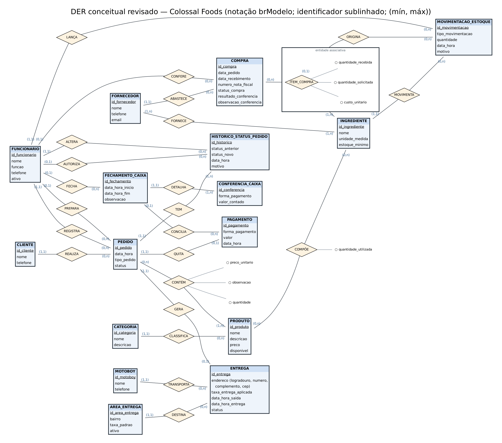
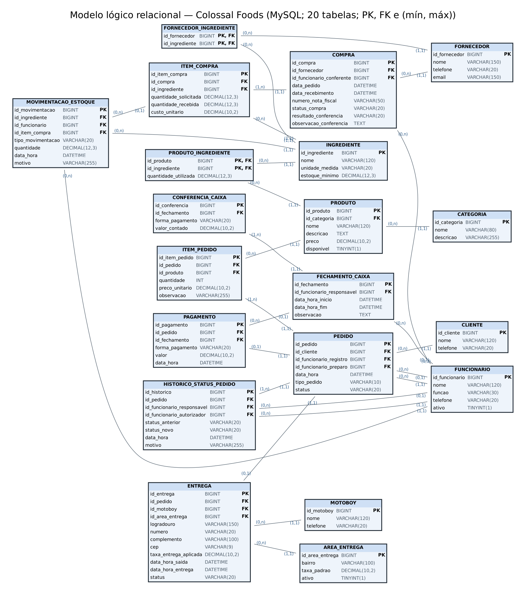

# Colossal Foods — Relatório Técnico Final (Entrega 2)

**Modelo lógico, implementação SQL e apresentação final** · Modelagem de um sistema de gestão de informações para uma organização de pequeno porte · Análise e Desenvolvimento de Sistemas — UNICID

## Integrantes

| Nome completo do aluno | RGM | Usuário do GitHub |
|---|---|---|
| Murilo Silva Magalhães | 47820471 | [mur1lxz](https://github.com/mur1lxz) |
| Kauê de Lima Pereira | 48477940 | [kauedelimapereira](https://github.com/kauedelimapereira) |

## Artefatos da entrega

| Artefato | Arquivo |
|---|---|
| Relatório técnico | este `README.md` |
| Levantamento completo | [levantamento/levantamento.md](levantamento/levantamento.md) |
| Evidências (fotos JPG/PNG) | [levantamento/evidencias/](levantamento/evidencias/) |
| DER conceitual revisado | [docs/diagramas/der-conceitual.png](docs/diagramas/der-conceitual.png) (fonte: [.dot](docs/diagramas/der-conceitual.dot)) |
| Modelo lógico | [docs/diagramas/modelo-logico.png](docs/diagramas/modelo-logico.png) (fonte: [.dot](docs/diagramas/modelo-logico.dot)) |
| Dicionário de dados (HTML único) | [docs/dicionario-dados.html](docs/dicionario-dados.html) |
| Script SQL completo + massa de dados | [docs/script.sql](docs/script.sql) |
| Guia de execução no MySQL | [docs/guia-execucao-mysql.md](docs/guia-execucao-mysql.md) |
| Roteiro do pitch | [apresentacao/roteiro-pitch.md](apresentacao/roteiro-pitch.md) |
| Material da Entrega 1 (histórico) | [entrega-1/](entrega-1/) |

> **⚠ Pendências que só o grupo pode resolver** estão marcadas com ⚠ ao longo do texto e resumidas no [final deste relatório](#pendências-antes-da-entrega). Nenhum dado de entrevista, nome ou foto foi inventado.

---

## 1.1 Revisão do Modelo Conceitual

### Caracterização da organização

**Nome e natureza.** Colossal Foods, hamburgueria — empresa privada com fins lucrativos — localizada na Rua do Carvalho Brasileiro, Jardim Arantes, São Paulo/SP, CEP 08382-520. É a mesma organização real da Entrega 1 (**Caso A**).

**Contexto e porte.**

| Indicador | Valor |
|---|---|
| Equipe interna | 4 funcionários: 2 na chapa/preparo e 2 no atendimento |
| Entregas | 1 motoboy fixo |
| Pedidos por dia, segunda a sexta | 30 a 50 (média ≈ 40) |
| Pedidos por dia, sábado e domingo | 60 a 90 (média ≈ 75) |
| Volume semanal estimado | ≈ 300 a 330 pedidos |
| Modalidades | retirada no balcão e delivery |
| Taxa de entrega | R$ 2,00 por entrega (informada pela organização) |
| Formas de pagamento | PIX, dinheiro, cartão de débito e cartão de crédito |
| Cardápio | digital, de empresa terceirizada (mensalidade); sem acesso ao banco da plataforma |

**Problemas e necessidades (crise operacional).** Hoje o pedido é consultado na tela do cardápio terceirizado e o restante da operação não tem registro estruturado. Os problemas de gestão de informações são:

| Código | Problema | Onde aparece no DER | Consulta |
|---|---|---|---|
| P1 | Não se sabe quanto tempo o delivery leva nem onde ele atrasa (preparo, espera do motoboy ou rota) | PEDIDO, HISTORICO_STATUS_PEDIDO, ENTREGA | G01, G12, G13 |
| P2 | Preço de venda é decidido sem histórico do preço praticado nem do custo dos ingredientes | ITEM_PEDIDO (CONTÉM), PRODUTO, COMPÕE, ITEM_COMPRA | G02, G03, G15 |
| P3 | Estoque de ingredientes sem registro de entradas/saídas e sem alerta de reposição | INGREDIENTE, MOVIMENTACAO_ESTOQUE | G04 |
| P4 | Cancelamentos sem motivo, responsável ou autorização registrados | HISTORICO_STATUS_PEDIDO | G05 |
| P5 | Fechamento do caixa sem valor esperado por forma de pagamento para comparar com o contado | PAGAMENTO, FECHAMENTO_CAIXA, CONFERENCIA_CAIXA | G06, G10 |
| P6 | Compras e recebimentos sem rastreabilidade de fornecedor, nota fiscal, quantidade e custo | FORNECEDOR, COMPRA, ITEM_COMPRA | G07 |
| P7 | Áreas atendidas e taxas de entrega sem cadastro; taxa cobrada não fica registrada | AREA_ENTREGA, ENTREGA | G08 |

P1 e P2 foram relatados na entrevista da Entrega 1. P3 a P7 foram identificados na revisão a partir dos processos da rotina e precisam ser confirmados com o responsável na visita de validação (ver [levantamento](levantamento/levantamento.md#5-problemas-identificados)).

**Escopo do sistema.** O banco reúne todos os dados da operação: clientes, cardápio, pedidos e itens, preparo e status, pagamentos, delivery, equipe, ingredientes e fichas técnicas, fornecedores, compras e recebimentos, estoque e fechamento de caixa. Fica fora apenas o que é da plataforma terceirizada de cardápio (o grupo não tem acesso a ela).

**Justificativa da escolha.** Organização real, acessível ao grupo, com processos completos de uma pequena empresa de alimentação (venda, produção, entrega, abastecimento e caixa) e problemas de informação concretos. ⚠ Declarar aqui se algum integrante tem vínculo com a organização.

**Evidências da organização.**

| Evidência | Situação |
|---|---|
| Perfil no Google (Google Meu Negócio/Maps) | “Colossal Foods — Jardim Arantes, São Paulo — SP”, nota 5,0 com 228 avaliações na consulta da Entrega 1 · [perfil no Google](https://share.google/RllPzCXwKrrXsxuzK) |
| Endereço e telefone | Rua do Carvalho Brasileiro, Jardim Arantes — São Paulo/SP — CEP 08382-520 · (11) 95950-6213 |
| Fotos JPG/PNG no repositório | ⚠ adicionar em [levantamento/evidencias/](levantamento/evidencias/) (fachada e entrevista) |

**Responsável pela organização.** Henrique Lemos, responsável pela Colossal Foods — telefone (11) 95950-6213 (telefone da loja).

### Relato da entrevista

| Item | Registro |
|---|---|
| Quem | Entrevistado: Henrique Lemos, responsável pela Colossal Foods · Integrante presente: Murilo Silva Magalhães |
| Quando e onde | Na própria Colossal Foods, durante a Entrega 1 (setembro de 2026, antes da primeira versão do projeto, publicada em 18/09/2026); a data exata não foi registrada |
| Comprovação | ⚠ foto da entrevista em `levantamento/evidencias/entrevista.jpg` |

**O que foi levantado (resumo).** Na Entrega 1 o grupo conversou com a equipe no local e levantou: a composição da equipe (observada), o volume médio de pedidos, o uso de um cardápio terceirizado consultado manualmente, o motoboy fixo, as formas de pagamento, a conferência coletiva do caixa ao fim do dia, a conferência de insumos com nota fiscal e a regra de cancelamento antes do preparo. **Observação × entrevista:** a composição da equipe e a consulta manual do cardápio foram vistas no local; volumes, formas de pagamento, regras de cancelamento e de recebimento foram informados pela equipe. Na revisão, processos típicos de hamburgueria (compras, estoque, áreas de entrega) foram levantados por pesquisa e ficaram marcados para confirmação. O texto organizado está em [levantamento/levantamento.md](levantamento/levantamento.md).

### Processos de negócio

| # | Processo | Dados envolvidos | Origem |
|---|---|---|---|
| 1 | **Cadastro do cliente** — no primeiro pedido, o atendimento registra o cliente | nome, telefone | Entrevista |
| 2 | **Recebimento do pedido** — o atendimento confere o pedido vindo do cardápio digital e registra | cliente, funcionário que registrou, data/hora, modalidade (RETIRADA/DELIVERY); para cada item: produto, quantidade, preço praticado e observação (ex.: “sem cebola”) | Entrevista/observação |
| 3 | **Preparo** — a chapa inicia o preparo e marca o pedido como pronto | funcionário do preparo, horários de EM_PREPARACAO e PRONTO | Entrevista |
| 4 | **Pagamento** — o pagamento é registrado e ligado ao pedido | forma de pagamento, valor (itens + taxa de entrega), data/hora | Entrevista |
| 5 | **Retirada** — o cliente retira no balcão e o pedido é finalizado | horário de FINALIZADO | Entrevista |
| 6 | **Delivery** — o motoboy leva o pedido ao endereço; a entrega é concluída antes de finalizar o pedido | motoboy, área/bairro, logradouro, número, complemento, CEP, taxa aplicada, horários de saída e de entrega, status | Entrevista |
| 7 | **Cancelamento** — antes do preparo é direto; depois do início do preparo exige justificativa e autorização | status anterior, motivo, responsável, autorizador, data/hora | Entrevista |
| 8 | **Compra de insumos** — pedido ao fornecedor | fornecedor, data do pedido; por ingrediente: quantidade solicitada e custo unitário | Pesquisa (confirmar) |
| 9 | **Recebimento e conferência de insumos** — conferência com a nota fiscal antes de armazenar | data de recebimento, número da NF, conferente, resultado (CONFORME/DIVERGENTE), quantidade recebida | Entrevista |
| 10 | **Movimentação de estoque** — entradas por compra, baixa do consumo do dia e ajustes por perda ou contagem | ingrediente, tipo, quantidade, data/hora, responsável, motivo | Pesquisa (confirmar) |
| 11 | **Fechamento de caixa** — ao fim do expediente a equipe conta os valores por forma de pagamento | responsável, início/fim do expediente, valor contado por forma de pagamento | Entrevista |
| 12 | **Manutenção do cardápio** — produtos por categoria, preço atual, disponibilidade e ficha técnica | categoria, nome, descrição, preço, disponível; ingredientes e quantidade por produto | Entrevista/pesquisa |
| 13 | **Cadastro de áreas de entrega e fornecedores** | bairro, taxa padrão, ativo; fornecedor e ingredientes que fornece | Pesquisa (confirmar) |

**Processos prováveis não incluídos:**

| Processo típico | Por que ficou de fora |
|---|---|
| Cardápio online, pedidos pela internet, integração com aplicativos | É feito pela plataforma terceirizada; o grupo não tem acesso a ela |
| Escala e ponto da equipe | Não foi relatado controle de escala; a equipe é pequena e fixa |
| Emissão de nota fiscal ao consumidor (NFC-e) | Obrigação fiscal tratada fora do sistema de gestão; ⚠ confirmar como é feita |
| Programa de fidelidade / cupons | Não identificado na organização |
| Contas a pagar e folha de pagamento | Fora do escopo operacional levantado; seria um módulo financeiro próprio |
| Controle de validade por lote de insumo | Não relatado; perdas por validade são registradas como ajuste de estoque |

### Requisitos funcionais

| Código | Requisito (com os dados envolvidos) | Problema |
|---|---|---|
| RF01 | Cadastrar cliente com nome completo e telefone (opcional para retirada). | — |
| RF02 | Cadastrar produto com categoria, nome, descrição, preço atual e indicador de disponível/indisponível; marcar produto como indisponível sem apagá-lo. | P2 |
| RF03 | Cadastrar categoria com nome único e descrição. | — |
| RF04 | Registrar pedido com cliente, funcionário que registrou, data/hora e modalidade (RETIRADA ou DELIVERY); o status inicial é RECEBIDO. | P1 |
| RF05 | Incluir no pedido um ou mais itens, cada um com produto, quantidade, preço unitário praticado no momento e observação. | P2 |
| RF06 | Calcular o valor total do pedido = soma de quantidade × preço unitário dos itens + taxa de entrega aplicada, quando DELIVERY. | P5 |
| RF07 | Registrar um pagamento por pedido com forma (PIX, dinheiro, débito, crédito), valor, data/hora e fechamento de caixa a que pertence. | P5 |
| RF08 | Identificar a modalidade do pedido (retirada ou delivery). | P1 |
| RF09 | Registrar a entrega com motoboy, área, logradouro, número, complemento, CEP, taxa aplicada, horários de saída e de entrega e status (AGUARDANDO, EM_ROTA, ENTREGUE). | P1, P7 |
| RF10 | Atualizar o status do pedido (RECEBIDO, EM_PREPARACAO, PRONTO, FINALIZADO, CANCELADO), registrando o funcionário do preparo. | P1 |
| RF11 | Cadastrar ingrediente com nome, unidade de medida e estoque mínimo, e a ficha técnica de cada produto (ingrediente e quantidade utilizada). | P2, P3 |
| RF12 | Cadastrar fornecedor com nome, telefone e e-mail e os ingredientes que ele fornece. | P6 |
| RF13 | Manter o histórico de pedidos sem apagar registros (cancelados permanecem com status CANCELADO). | P4 |
| RF14 | Cadastrar funcionário com nome, função (ATENDIMENTO ou CHAPA), telefone e situação (ativo/inativo). | — |
| RF15 | Registrar compra com fornecedor, data do pedido, status (PENDENTE, RECEBIDA, CANCELADA) e itens com ingrediente, quantidade solicitada e custo unitário. | P2, P6 |
| RF16 | Registrar o recebimento da compra com data, número da nota fiscal, funcionário conferente, resultado (CONFORME/DIVERGENTE), observação e quantidade recebida de cada item. | P6 |
| RF17 | Registrar movimentação de estoque com ingrediente, tipo (ENTRADA, SAIDA, AJUSTE_ENTRADA, AJUSTE_SAIDA), quantidade, data/hora, funcionário, motivo e, para entradas de compra, o item de compra de origem. | P3 |
| RF18 | Cadastrar área de entrega com bairro, taxa padrão e situação ativa/inativa. | P7 |
| RF19 | Registrar o fechamento de caixa com responsável, início e fim do expediente e o valor contado de cada forma de pagamento. | P5 |
| RF20 | Registrar cada mudança de status do pedido com status anterior, novo status, data/hora, responsável e, no cancelamento, motivo e autorizador. | P1, P4 |
| RF21 | Emitir os relatórios gerenciais G01–G15 (tempos, preços, custos, estoque, cancelamentos, caixa, compras, entregas, ticket médio, mix de vendas, recompra e CMV). | P1–P7 |

### Requisitos não funcionais

| Código | Requisito |
|---|---|
| RNF01 | Usabilidade: registrar um pedido em poucos passos, compatível com o ritmo do atendimento no pico. |
| RNF02 | Segurança: acesso por perfil (atendimento, chapa, gerência); apenas gerência altera preços e autoriza cancelamentos após o preparo. |
| RNF03 | Disponibilidade: funcionar durante todo o expediente (18h às 23h30). |
| RNF04 | Desempenho: registrar e consultar pedidos em menos de 2 segundos com o volume de um ano (≈ 16 mil pedidos); índices nas colunas de filtro (data, status, cliente). |
| RNF05 | Integridade: chaves estrangeiras, CHECK e triggers impedem dados inconsistentes; registros com histórico não são apagados (ON DELETE RESTRICT). |
| RNF06 | Privacidade (LGPD): dados de clientes usados só para atendimento e entrega; acesso restrito a telefone e endereço. |
| RNF07 | Backup diário do banco de dados. |

**Requisitos prováveis não incluídos:** pedido online/QR Code e integração com aplicativos de entrega (feitos pela plataforma terceirizada); emissão de NFC-e (fora do escopo de gestão); controle de mesas (a loja atende retirada e delivery); multiloja (há uma unidade).

### Regras de negócio

Os códigos RN01–RN20 são os da Entrega 1; RN21–RN25 foram acrescentados nesta revisão.

| Código | Regra | Como é garantida |
|---|---|---|
| RN01 | Cada pedido pertence a um único cliente; um cliente pode fazer vários pedidos. | FK NOT NULL |
| RN02 | Todo pedido tem ao menos um item. | Trigger no pagamento; auditoria A01 |
| RN03 | Um produto pode aparecer em vários pedidos. | Tabela ITEM_PEDIDO |
| RN04 | Cada produto pertence a exatamente uma categoria. | FK NOT NULL |
| RN05 | Produto indisponível não pode entrar em novo pedido. | Trigger em ITEM_PEDIDO |
| RN06 | A quantidade de cada item é maior que zero. | CHECK |
| RN07 | O item guarda o preço praticado na venda; mudar o preço do produto não altera pedidos antigos. | Coluna preco_unitario |
| RN08 | Cada pedido tem no máximo um pagamento, igual aos itens + taxa de entrega. | UNIQUE + trigger; A02 |
| RN09 | Todo pedido é RETIRADA ou DELIVERY. | CHECK |
| RN10 | Pedido de retirada não tem entrega. | Trigger em ENTREGA; A03 |
| RN11 | Pedido de delivery não cancelado tem uma entrega. | UNIQUE; A03 |
| RN12 | Cada entrega tem um motoboy responsável. | FK NOT NULL; A04 |
| RN13 | Toda entrega tem endereço de destino (logradouro e número). | NOT NULL |
| RN14 | Delivery só é finalizado depois da entrega concluída. | Trigger em PEDIDO; A12 |
| RN15 | Produtos preparados têm ficha técnica; industrializados (ex.: água) podem não ter. | PRODUTO_INGREDIENTE opcional |
| RN16 | Um ingrediente pode ter vários fornecedores e um fornecedor vários ingredientes. | FORNECEDOR_INGREDIENTE |
| RN17 | Cancelamento exige motivo; após o início do preparo exige também autorizador. | Trigger no histórico; A07 |
| RN18 | Formas aceitas: PIX, dinheiro, débito e crédito; o total por forma deve bater com o contado no fechamento. | CHECK; A08, A11 |
| RN19 | Delivery só para área ativa; a taxa aplicada é a taxa padrão da área e fica registrada na entrega. | Trigger em ENTREGA |
| RN20 | Recebimento de insumos exige conferência com nota fiscal e respeito às normas sanitárias. | Trigger em COMPRA; A10 |
| RN21 | Compra só passa a RECEBIDA com NF, data de recebimento, conferente, resultado da conferência e ao menos um item recebido. | Trigger em COMPRA; A10 |
| RN22 | Saldo do ingrediente = entradas + ajustes de entrada − saídas − ajustes de saída; nunca negativo. | Consulta; A05 |
| RN23 | Entrada vinculada a item de compra é do tipo ENTRADA, do mesmo ingrediente e não supera a quantidade recebida. | Trigger; A06 |
| RN24 | Toda mudança de status gera histórico; o status atual é o do último evento. | A09 |
| RN25 | Pedido finalizado tem pagamento registrado; pedido cancelado não mantém pagamento. | A13 |

**Regras prováveis não incluídas:** idade mínima para bebida alcoólica (o cardápio modelado não tem bebida alcoólica); desconto por fidelidade (não existe na loja); limite de troco ou valor mínimo de pedido (não relatados); validade por lote (perdas são registradas como ajuste de estoque). Exigências da LGPD aparecem como RNF06.

### DER conceitual revisado



- **Software:** Graphviz (linguagem DOT), gerado pelo script [docs/diagramas/gerar_diagramas.py](docs/diagramas/gerar_diagramas.py), na notação do brModelo: entidades em retângulo com os atributos listados e o **identificador sublinhado**; relacionamentos em losango; cardinalidade **(mín, máx)** dos dois lados de cada relacionamento; atributos de relacionamento ligados ao losango (○); **entidade associativa** ITEM_COMPRA como retângulo envolvendo o losango. Sem chaves estrangeiras. ⚠ Se o professor exigir o arquivo do próprio brModelo, redesenhar o mesmo diagrama nele.
- **Leitura da cardinalidade:** o par ao lado de uma entidade indica quantas ocorrências dela se ligam a uma ocorrência da entidade do outro lado (ex.: CLIENTE (1,1) — REALIZA — (0,n) PEDIDO: cada pedido tem exatamente um cliente; cada cliente tem zero ou mais pedidos).
- **Atributo composto:** endereço da entrega (logradouro, número, complemento, CEP). Não há atributo multivalorado nem generalização/especialização.
- **Atributos derivados** (valor total do pedido e saldo de estoque) não aparecem no DER; são calculados por consulta.

**Caso A — apontamentos da correção da Entrega 1**

| Apontamento da correção da E1 | O que mudou no trabalho | Por quê |
|---|---|---|
| Modelo cobria só parte da organização | Entraram FUNCIONARIO, COMPRA, ITEM_COMPRA, MOVIMENTACAO_ESTOQUE, FECHAMENTO_CAIXA, CONFERENCIA_CAIXA, HISTORICO_STATUS_PEDIDO e AREA_ENTREGA | O banco precisa reunir todos os dados da operação, não só pedidos |
| Problemas declarados sem estrutura no DER | Problemas numerados P1–P7, cada um com entidades e consulta (tabela acima) | Todo problema precisa ser resolvido pelo modelo |
| Quantidade e preço praticado na relação pedido–produto | Mantidos como atributos de CONTÉM; viram ITEM_PEDIDO no lógico | Sem eles não se sabe quanto foi vendido nem por qual preço (P2) |
| Produto vendido × ingrediente consumido | PRODUTO ligado a INGREDIENTE por COMPÕE, com quantidade utilizada | Ficha técnica permite calcular custo e consumo |
| Fornecedor ligado ao ingrediente | FORNECE (N:N) e compras com itens por ingrediente | Rastreabilidade de compras e custos (P6) |
| Cancelamento sem registro | HISTORICO_STATUS_PEDIDO com motivo e autorizador | RN17 e P4 |
| Caixa conferido por forma de pagamento | FECHAMENTO_CAIXA e CONFERENCIA_CAIXA | RN18 e P5 |
| Taxa de entrega sem cadastro | AREA_ENTREGA; taxa aplicada guardada na ENTREGA | RN19 e P7 |
| Atributo derivado (valor_total) desenhado no DER | Removido do DER; calculado por consulta | A notação exigida não prevê atributo derivado e o valor seria redundante |
| Requisitos genéricos | Reescritos com os dados envolvidos | Exigência de nível de detalhe |

⚠ Conferir esta tabela com o texto exato da correção recebida: todo apontamento precisa aparecer aqui (inclusive os de que o grupo discordar, com justificativa).

---

## 1.2 Conversão do Modelo Conceitual para o Modelo Lógico

- **Entidades → tabelas:** cada uma das 16 entidades virou uma tabela com o mesmo nome (CLIENTE, PEDIDO, PRODUTO, CATEGORIA, INGREDIENTE, FORNECEDOR, PAGAMENTO, ENTREGA, MOTOBOY, AREA_ENTREGA, FUNCIONARIO, HISTORICO_STATUS_PEDIDO, COMPRA, MOVIMENTACAO_ESTOQUE, FECHAMENTO_CAIXA, CONFERENCIA_CAIXA).
- **Atributos → colunas:** atributos simples viraram colunas com tipo MySQL (detalhes no [dicionário](docs/dicionario-dados.html)); o atributo composto endereço foi decomposto em `logradouro`, `numero`, `complemento` e `cep`; o identificador virou a PK.
- **Relacionamentos 1:N:** FK no lado N — ex.: REALIZA → `PEDIDO.id_cliente`; CLASSIFICA → `PRODUTO.id_categoria`; TRANSPORTA → `ENTREGA.id_motoboy`; ABASTECE → `COMPRA.id_fornecedor`. Quando a participação é opcional (0,1), a FK aceita NULL (ex.: `PEDIDO.id_funcionario_preparo`, `PAGAMENTO.id_fechamento`). Quando há dois relacionamentos com a mesma entidade, há duas FKs com nomes de papel (REGISTRA/PREPARA → `id_funcionario_registro`/`id_funcionario_preparo`; ALTERA/AUTORIZA → `id_funcionario_responsavel`/`id_funcionario_autorizador`).
- **Relacionamentos 1:1:** QUITA (PEDIDO–PAGAMENTO) e GERA (PEDIDO–ENTREGA) são (1,1)–(0,1). A FK ficou no lado opcional (`PAGAMENTO.id_pedido`, `ENTREGA.id_pedido`) com **UNIQUE**, para garantir no máximo um registro por pedido sem colunas nulas em PEDIDO.
- **Relacionamentos N:N:** viraram tabelas associativas — CONTÉM → **ITEM_PEDIDO** (com quantidade, preço unitário e observação), COMPÕE → **PRODUTO_INGREDIENTE** (PK composta + quantidade utilizada), FORNECE → **FORNECEDOR_INGREDIENTE** (PK composta). A entidade associativa ITEM_COMPRA virou a tabela **ITEM_COMPRA**, e o relacionamento ORIGINA virou `MOVIMENTACAO_ESTOQUE.id_item_compra` (FK opcional).
- **Generalização/especialização:** não há no DER. FUNCIONARIO e MOTOBOY poderiam ser especializações de uma entidade PESSOA, mas não compartilham relacionamentos nem regras, então foram mantidos como entidades independentes (ver 1.5).

## 1.3 Definição de Chaves Primárias e Estrangeiras

| Tabela | PK | FKs |
|---|---|---|
| CLIENTE | id_cliente | — |
| CATEGORIA | id_categoria | — |
| PRODUTO | id_produto | id_categoria → CATEGORIA |
| INGREDIENTE | id_ingrediente | — |
| PRODUTO_INGREDIENTE | (id_produto, id_ingrediente) | id_produto → PRODUTO; id_ingrediente → INGREDIENTE |
| FORNECEDOR | id_fornecedor | — |
| FORNECEDOR_INGREDIENTE | (id_fornecedor, id_ingrediente) | id_fornecedor → FORNECEDOR; id_ingrediente → INGREDIENTE |
| FUNCIONARIO | id_funcionario | — |
| MOTOBOY | id_motoboy | — |
| AREA_ENTREGA | id_area_entrega | — |
| PEDIDO | id_pedido | id_cliente → CLIENTE; id_funcionario_registro, id_funcionario_preparo → FUNCIONARIO |
| ITEM_PEDIDO | id_item_pedido | id_pedido → PEDIDO; id_produto → PRODUTO |
| PAGAMENTO | id_pagamento | id_pedido → PEDIDO (UNIQUE); id_fechamento → FECHAMENTO_CAIXA |
| ENTREGA | id_entrega | id_pedido → PEDIDO (UNIQUE); id_motoboy → MOTOBOY; id_area_entrega → AREA_ENTREGA |
| HISTORICO_STATUS_PEDIDO | id_historico | id_pedido → PEDIDO; id_funcionario_responsavel, id_funcionario_autorizador → FUNCIONARIO |
| COMPRA | id_compra | id_fornecedor → FORNECEDOR; id_funcionario_conferente → FUNCIONARIO |
| ITEM_COMPRA | id_item_compra | id_compra → COMPRA; id_ingrediente → INGREDIENTE (par único) |
| MOVIMENTACAO_ESTOQUE | id_movimentacao | id_ingrediente → INGREDIENTE; id_funcionario → FUNCIONARIO; id_item_compra → ITEM_COMPRA |
| FECHAMENTO_CAIXA | id_fechamento | id_funcionario_responsavel → FUNCIONARIO |
| CONFERENCIA_CAIXA | id_conferencia | id_fechamento → FECHAMENTO_CAIXA (único com forma_pagamento) |

Total: 20 tabelas e 27 chaves estrangeiras.

## 1.4 Processo de Normalização (1FN, 2FN e 3FN)

Partimos da “ficha do pedido” como ela circula hoje — uma linha com tudo junto:

`PEDIDO_BRUTO(id_pedido, data_hora, cliente_nome, cliente_telefone, tipo, endereço, bairro, taxa, motoboy, motoboy_telefone, forma_pagamento, valor_pago, itens = {produto, categoria, preço, quantidade, observação}, ...)`

- **1FN — atributos atômicos e sem grupos repetitivos.** Os itens são um grupo repetitivo (vários produtos por pedido): foram para uma relação própria **ITEM_PEDIDO**(id_pedido, produto, quantidade, preço, observação). O endereço composto foi separado em `logradouro`, `numero`, `complemento`, `cep`. O mesmo ocorreu com os itens da compra (**ITEM_COMPRA**), os valores contados por forma de pagamento (**CONFERENCIA_CAIXA**, uma linha por forma) e os eventos de status (**HISTORICO_STATUS_PEDIDO**, uma linha por mudança, em vez de colunas hora_preparo, hora_pronto…).
- **2FN — sem dependência parcial da chave composta.** Em ITEM_PEDIDO com chave (id_pedido, id_produto), o nome, a categoria e o preço atual do produto dependem só de id_produto: foram para **PRODUTO**. Ficaram em ITEM_PEDIDO apenas quantidade, preço praticado e observação, que dependem do par. Da mesma forma, em PRODUTO_INGREDIENTE só `quantidade_utilizada` depende do par; nome e unidade do ingrediente foram para **INGREDIENTE**. Em ITEM_COMPRA, dados do fornecedor e da nota dependem só da compra e foram para **COMPRA**.
- **3FN — sem dependência transitiva.** Em PEDIDO, `cliente_telefone` dependia de cliente, e não do pedido → **CLIENTE**. Em ENTREGA, `motoboy_telefone` dependia do motoboy → **MOTOBOY**; a taxa padrão dependia do bairro → **AREA_ENTREGA**. Em PRODUTO, a descrição da categoria dependia da categoria → **CATEGORIA**. Em COMPRA, telefone/e-mail do fornecedor → **FORNECEDOR**.
- **Por que foi necessário:** sem a 1FN não dá para somar vendas por produto; sem a 2FN, mudar o nome de um produto exigiria alterar todos os itens vendidos; sem a 3FN, mudar a taxa de um bairro exigiria alterar todas as entregas e haveria entregas com taxas inconsistentes.
- **Redundância controlada (decisão consciente):** `ITEM_PEDIDO.preco_unitario`, `ITEM_COMPRA.custo_unitario` e `ENTREGA.taxa_entrega_aplicada` repetem valores que também existem no cadastro. Não violam a 3FN: dependem da venda/compra/entrega naquele momento (valor histórico), não do produto ou da área atuais (RN07, RN19). Já o valor total do pedido e o saldo de estoque **não** são armazenados, porque seriam dependências calculáveis.

## 1.5 Justificativas Técnicas das Decisões

**Chaves primárias.** Chaves artificiais `BIGINT UNSIGNED AUTO_INCREMENT` em todas as entidades: nome e telefone mudam e não são únicos (dois clientes podem ter o mesmo nome; o telefone é opcional), e o cardápio terceirizado não fornece um código confiável. Nas associativas sem atributos próprios além da quantidade (PRODUTO_INGREDIENTE, FORNECEDOR_INGREDIENTE), a PK composta pelas duas FKs impede repetir o mesmo par. ITEM_PEDIDO tem PK própria porque o mesmo produto pode aparecer duas vezes no pedido com observações diferentes (“um sem cebola, um normal”). ITEM_COMPRA tem PK própria porque é referenciada por MOVIMENTACAO_ESTOQUE; a unicidade do par (compra, ingrediente) fica num UNIQUE.

**Chaves estrangeiras.** Todas com `ON DELETE RESTRICT` (não se apaga cliente, produto ou funcionário com histórico — RF13) e `ON UPDATE CASCADE`. FKs opcionais representam participação (0,1): preparo ainda não iniciado, pagamento ainda não conciliado, compra ainda não conferida, entrada de estoque que não veio de compra.

**Restrições e regras atendidas.**

| Restrição | Onde | Regra |
|---|---|---|
| NOT NULL em `PEDIDO.id_cliente`, `PRODUTO.id_categoria`, `ENTREGA.id_motoboy` | FKs obrigatórias | RN01, RN04, RN12 |
| NOT NULL em `ENTREGA.logradouro` e `numero` | endereço | RN13 |
| UNIQUE em `PAGAMENTO.id_pedido` e `ENTREGA.id_pedido` | 1:1 | RN08, RN11 |
| UNIQUE em `CATEGORIA.nome`, `AREA_ENTREGA.bairro`, `(id_fechamento, forma_pagamento)`, `(id_compra, id_ingrediente)` | sem duplicidade | RN04, RN18, RN19, RN21 |
| CHECK `quantidade > 0`, `preco > 0`, `valor > 0`, taxas e custos ≥ 0 | valores | RN06, RN08 |
| CHECK `tipo_pedido IN ('RETIRADA','DELIVERY')` | domínio | RN09 |
| CHECK `forma_pagamento IN ('PIX','DINHEIRO','CARTAO_DEBITO','CARTAO_CREDITO')` | domínio | RN18 |
| CHECK de status (pedido, entrega, compra, conferência, movimentação) | domínio | RN17, RN21, RN22 |
| CHECK `data_hora_entrega >= data_hora_saida` | coerência | RN14 |
| DEFAULT `status = 'RECEBIDO'`, `disponivel = 1`, `ativo = 1`, `status_compra = 'PENDENTE'` | valor inicial | RF04, RF15 |
| 11 triggers (`trg_item_pedido_*`, `trg_pagamento_*`, `trg_entrega_*`, `trg_pedido_bu`, `trg_compra_*`, `trg_movimentacao_estoque_bi`, `trg_historico_status_bi`) | regras entre tabelas | RN05, RN08, RN10, RN14, RN17, RN19, RN20, RN21, RN23 |

**Decisões gerais.** MySQL 8.0.16+ com InnoDB (FKs e CHECK efetivos); `utf8mb4`; `DECIMAL(10,2)` para dinheiro (sem erro de arredondamento); `DECIMAL(12,3)` para quantidades em g/ml; `DATETIME` em horário local. Estoque por **movimentação** (não por coluna de saldo), para ter histórico auditável. Status atual em PEDIDO + histórico completo em tabela própria, para consultar rápido e ainda medir tempos. MOTOBOY separado de FUNCIONARIO porque só se relaciona com ENTREGA e pode ser substituído por entregador parceiro sem entrar na equipe interna. Regras que envolvem mais de uma tabela ficaram em triggers e são conferidas também pelas consultas de auditoria.

## 1.6 Proposta de Arquitetura Analítica para BI e IA

**Informações estratégicas.** Onde o delivery atrasa (preparo, espera do motoboy ou rota) e em que horários; quanto cada produto custa em ingredientes frente ao preço; quando repor cada insumo; quanto se perde com cancelamentos e descartes; se o caixa fecha; quais produtos e clientes sustentam o faturamento.

**KPIs.** Metas são propostas do grupo, ⚠ a validar com o responsável.

| KPI | Fórmula | Período | Meta proposta | Consulta |
|---|---|---|---|---|
| K01 Tempo médio até pronto | média(PRONTO − RECEBIDO), deliveries finalizados | dia | ≤ 20 min | G01 |
| K02 Tempo médio em rota | média(entrega − saída) | dia | ≤ 15 min | G01 |
| K03 Deliveries no prazo | entregas com (entrega − pedido) ≤ 45 min ÷ entregas × 100 | dia | ≥ 85% | G12 |
| K04 Demanda e tempo por faixa horária | pedidos e tempo médio de delivery por hora | semana × fim de semana | — (dimensionamento) | G13 |
| K05 Preço praticado × atual | preço médio, mínimo e máximo praticado por produto | período | — | G02 |
| K06 CMV teórico | Σ(quantidade da ficha × último custo) ÷ preço × 100 | atual | ≤ 35% | G15 |
| K07 Custo médio de aquisição | Σ(qtd × custo) ÷ Σ qtd por ingrediente | mês | variação ≤ 5% ao mês | G03 |
| K08 Ingredientes abaixo do mínimo | contagem de saldo < estoque mínimo | dia | 0 | G04 |
| K09 Ticket médio | faturamento ÷ pedidos finalizados, por modalidade | dia | — | G09 |
| K10 Participação por forma de pagamento | valor da forma ÷ total × 100 | semana | — | G10 |
| K11 Mix de vendas | receita do produto ÷ receita total × 100 | período | — | G11 |
| K12 Taxa de recompra | clientes com 2+ pedidos ÷ clientes com pedido × 100 | período | ≥ 60% | G14 |
| K13 Taxa de cancelamento | cancelados ÷ pedidos × 100 | dia | ≤ 3% | G05 |
| K14 Diferença de caixa | contado − esperado, por forma | fechamento | R$ 0,00 | G06 |
| K15 Compras por fornecedor | Σ quantidade e Σ custo por fornecedor/ingrediente | período | — | G07 |
| K16 Entregas e taxas por área | contagem e Σ taxa por bairro | período | — | G08 |

**Potencial para BI.** A estrutura já é um modelo estrela em potencial: PEDIDO/ITEM_PEDIDO, PAGAMENTO, ENTREGA, MOVIMENTACAO_ESTOQUE e ITEM_COMPRA são **fatos** (com data/hora e valores), e CLIENTE, PRODUTO, CATEGORIA, INGREDIENTE, FORNECEDOR, FUNCIONARIO, AREA_ENTREGA e uma dimensão de tempo derivada das colunas `data_hora` são **dimensões**. As consultas G01–G15 podem virar views e alimentar um painel (Power BI, Looker Studio ou Metabase) com: operação do dia (pedidos, ticket, tempo de delivery), caixa, estoque com alertas e custos/CMV.

**Aplicações de IA.** Com alguns meses de histórico: previsão de demanda por dia e hora (séries temporais com G13) para escalar equipe e motoboy; previsão de consumo e sugestão de compra por ingrediente (consumo por ficha técnica + histórico de movimentação); alerta de anomalia no caixa e no estoque (desvios em G06/A08 e ajustes de saída frequentes); recomendação de combos a partir de produtos vendidos juntos (ITEM_PEDIDO); estimativa de tempo de entrega por área e horário. Exigem histórico real validado e acompanhamento humano.

**Rastreabilidade.**

| Problema ou KPI | Tabelas envolvidas | Consulta no script |
|---|---|---|
| P1 — tempo de expedição do delivery | PEDIDO, HISTORICO_STATUS_PEDIDO, ENTREGA | G01, G12, G13 |
| P2 — preço × custo | PRODUTO, ITEM_PEDIDO, PEDIDO, PRODUTO_INGREDIENTE, ITEM_COMPRA, COMPRA | G02, G03, G15 |
| P3 — estoque sem controle | INGREDIENTE, MOVIMENTACAO_ESTOQUE | G04 |
| P4 — cancelamentos | PEDIDO, HISTORICO_STATUS_PEDIDO | G05 |
| P5 — conferência do caixa | PAGAMENTO, FECHAMENTO_CAIXA, CONFERENCIA_CAIXA | G06, G10 |
| P6 — compras e fornecedores | FORNECEDOR, COMPRA, ITEM_COMPRA, INGREDIENTE | G07 |
| P7 — áreas e taxas | AREA_ENTREGA, ENTREGA | G08 |
| K01/K02 | PEDIDO, HISTORICO_STATUS_PEDIDO, ENTREGA | G01 |
| K03 | PEDIDO, ENTREGA | G12 |
| K04 | PEDIDO, ENTREGA | G13 |
| K05 | PRODUTO, ITEM_PEDIDO, PEDIDO | G02 |
| K06 | PRODUTO, PRODUTO_INGREDIENTE, ITEM_COMPRA, COMPRA | G15 |
| K07 | INGREDIENTE, ITEM_COMPRA, COMPRA | G03 |
| K08 | INGREDIENTE, MOVIMENTACAO_ESTOQUE | G04 |
| K09 | PEDIDO, PAGAMENTO | G09 |
| K10 | PAGAMENTO, FECHAMENTO_CAIXA | G10 |
| K11 | PRODUTO, CATEGORIA, ITEM_PEDIDO, PEDIDO | G11 |
| K12 | CLIENTE, PEDIDO | G14 |
| K13 | PEDIDO | G05 |
| K14 | PAGAMENTO, FECHAMENTO_CAIXA, CONFERENCIA_CAIXA | G06 |
| K15 | FORNECEDOR, COMPRA, ITEM_COMPRA, INGREDIENTE | G07 |
| K16 | AREA_ENTREGA, ENTREGA | G08 |

---

## 2. Modelo Lógico Relacional



- **Software:** Graphviz (DOT), gerado por [docs/diagramas/gerar_diagramas.py](docs/diagramas/gerar_diagramas.py) **lendo diretamente o `docs/script.sql`** — assim o diagrama não diverge do banco implementado. Notação do brModelo para o modelo lógico: tabela com uma linha por coluna, tipo à direita e marcas **PK**, **FK** ou **PK, FK**; ligação entre a tabela da FK e a referenciada com (mín, máx) em cada ponta. ⚠ Se o professor exigir o arquivo do brModelo, redesenhar no brModelo a partir desta figura.
- 20 tabelas, 27 chaves estrangeiras. Versão vetorial: [modelo-logico.svg](docs/diagramas/modelo-logico.svg).
- NOT NULL, UNIQUE, CHECK e DEFAULT estão no [dicionário de dados](docs/dicionario-dados.html) e no script.

---

## 3. Script SQL Completo

Arquivo: **[docs/script.sql](docs/script.sql)** — MySQL 8.0.16 ou superior. Ordem: `DROP/CREATE DATABASE` (recria o banco a cada execução) → `CREATE TABLE` com PK, FK, NOT NULL, UNIQUE, CHECK e DEFAULT → 11 triggers → `INSERT INTO` (massa) → `SELECT` com `JOIN` → `UPDATE` → `DELETE` → consultas gerenciais **G01–G15** → consultas de auditoria **A01–A13** → testes das triggers **T01–T10** (comentados, para executar um a um na demonstração).

| Gerenciais | Pergunta |
|---|---|
| G01 | Tempo médio de preparo e de rota dos deliveries, por dia |
| G02 | Preço atual × preço praticado por produto |
| G03 | Custo médio de aquisição por ingrediente e mês |
| G04 | Ingredientes abaixo do estoque mínimo |
| G05 | Pedidos cancelados e percentual por dia |
| G06 | Valor esperado × contado no fechamento, por forma |
| G07 | Compras por fornecedor e ingrediente |
| G08 | Entregas e taxas por área |
| G09 | Ticket médio por dia e modalidade |
| G10 | Faturamento semanal e participação por forma de pagamento |
| G11 | Mix de vendas por produto e categoria |
| G12 | % de deliveries entregues em até 45 minutos |
| G13 | Demanda e tempo de delivery por faixa horária |
| G14 | Clientes ativos, recorrentes e sem pedido |
| G15 | CMV teórico por produto |

| Auditoria | Regra verificada |
|---|---|
| A01 | RN02 — pedido sem item |
| A02 | RN08/RN19 — pagamento ≠ itens + taxa |
| A03 | RN10/RN11 — retirada com entrega ou delivery ativo sem entrega |
| A04 | RN12 — entrega sem motoboy |
| A05 | RN22 — saldo de estoque negativo |
| A06 | RN23 — entrada de compra incoerente |
| A07 | RN17 — cancelamento sem motivo ou autorização |
| A08 | RN18 — forma de pagamento sem conferência ou com diferença |
| A09 | RN24 — status atual ≠ último evento do histórico |
| A10 | RN20/RN21 — compra recebida sem NF, data, conferente ou item |
| A11 | RN18 — fechamento sem conferência |
| A12 | RN14 — delivery finalizado sem entrega concluída |
| A13 | RN25 — finalizado sem pagamento ou cancelado com pagamento |

Passo a passo e resultados esperados: [docs/guia-execucao-mysql.md](docs/guia-execucao-mysql.md).

**Status de teste:** o script completo foi executado do zero pelo grupo em 12/11/2026 e terminou sem erros (o script recria o banco a cada execução).

---

## 4. Massa de Dados

A massa está no próprio `docs/script.sql` (seção 3) e é **inteiramente fictícia** (“Cliente Ficticio 001”, telefones e ruas fictícios, notas “NF-DEMO”). Foi gerada pelo programa [docs/gerador-massa/gerar_massa.py](docs/gerador-massa/gerar_massa.py), com semente fixa (o resultado é sempre o mesmo), que simula **duas semanas completas de operação — 26/10 a 08/11/2026** — seguindo as regras da organização.

| Tabela | Registros | Justificativa pelo volume real |
|---|---:|---|
| PEDIDO | 690 | 10 dias úteis com 30–50 pedidos (média 40) + 4 dias de fim de semana com 60–90 (média 72) — dentro das faixas informadas |
| ITEM_PEDIDO | 1.497 | ≈ 2,2 itens por pedido (lanche + acompanhamento/bebida) |
| HISTORICO_STATUS_PEDIDO | 2.735 | ≈ 4 eventos por pedido (recebido, em preparo, pronto, finalizado/cancelado) |
| PAGAMENTO | 672 | 1 por pedido finalizado |
| ENTREGA | 157 | ≈ 27% dos pedidos em dia útil e 22% no fim de semana são delivery |
| CLIENTE | 150 | clientes recorrentes do bairro; 20 cadastrados sem pedido no período |
| FECHAMENTO_CAIXA / CONFERENCIA_CAIXA | 14 / 56 | 1 fechamento por dia; 1 conferência por forma usada |
| COMPRA / ITEM_COMPRA | 26 / 67 | entregas de 4 fornecedores em 2 a 4 dias por semana |
| MOVIMENTACAO_ESTOQUE | 262 | inventário inicial (13), entradas de compra (63), baixa diária do consumo por ingrediente (182), ajustes (4) |
| PRODUTO / CATEGORIA / INGREDIENTE | 12 / 5 / 13 | cardápio enxuto de hamburgueria |
| FUNCIONARIO / MOTOBOY / AREA_ENTREGA / FORNECEDOR | 5 / 1 / 4 / 4 | equipe real (4 + 1 inativo), 1 motoboy fixo |

**Situações cobertas para os testes:** retirada e delivery; quatro formas de pagamento; 18 cancelamentos (12 antes do preparo, 6 depois, com autorizador); reajuste do Bacon Burger e da Batata Frita em 02/11 (preço histórico ≠ atual) e reajuste do Colossal Burger no `UPDATE`; produto indisponível nunca vendido; clientes sem pedido; área de entrega e funcionário inativos; motoboy único levando até 4 pedidos por saída (os tempos de entrega pioram nos picos de fim de semana); compra com divergência na conferência, compra cancelada e compra pendente; ajustes de estoque por descarte e por contagem; **refrigerante e chocolate abaixo do mínimo** no fim do período (G04); **duas quebras de caixa** (falta de R$ 5,00 em 29/10 e sobra de R$ 2,00 em 06/11), que a auditoria A08 encontra de propósito. As demais auditorias retornam zero linhas. A consistência do consumo é real: a baixa de estoque é calculada pela ficha técnica dos produtos vendidos.

**Taxa de entrega:** R$ 2,00 em todas as áreas, conforme informado pela organização. **Parâmetros ilustrativos** (⚠ confirmar com a organização): bairros atendidos além do Jardim Arantes, estoques mínimos, dias de entrega dos fornecedores, funcionamento diário das 18h às 23h30.

---

## 5. Repositório GitHub

```
README.md                         relatório técnico (este arquivo)
levantamento/levantamento.md      levantamento organizado
levantamento/evidencias/          fotos JPG/PNG da organização e da entrevista
docs/script.sql                   script SQL completo com a massa de dados
docs/dicionario-dados.html        dicionário de dados (arquivo único)
docs/diagramas/                   DER conceitual e modelo lógico (PNG, SVG e fonte .dot)
docs/guia-execucao-mysql.md       como executar e validar
docs/gerador-massa/               gerador da massa fictícia
docs/gerador-dicionario/          gerador do dicionário a partir do script
apresentacao/roteiro-pitch.md     roteiro do pitch de 8 minutos
entrega-1/                        material original da Entrega 1
```

⚠ **Colaboração:** o histórico atual tem commits de uma única conta (mur1lxz). O roteiro avalia commits equilibrados entre os integrantes, cada um com a própria conta e com nome compatível com a tabela de Integrantes.

---

## 6. Uso de Inteligência Artificial

| Item | Uso 1 — levantamento (E1) | Uso 2 — DER e requisitos (E1) | Uso 3 — modelo lógico e SQL (E2) | Uso 4 — revisão final e apresentação (E2) |
|---|---|---|---|---|
| Ferramenta e etapa | ChatGPT — roteiro de entrevista e processos típicos | ChatGPT e Claude — entidades, DER, dicionário | ChatGPT — conversão, chaves, restrições, consultas e primeira massa | Claude (Anthropic) — revisão do repositório frente ao roteiro da E2, massa de dados, consultas G09–G15, diagramas, dicionário, slides e roteiro de fala |
| Motivação | Preparar a visita a uma hamburgueria | Revisar coerência entre README, DER e dicionário | Apoio na conversão e na escrita do SQL | Adequar todos os artefatos ao novo esqueleto no prazo; a IA foi apoio de produtividade, com o grupo fornecendo os dados da loja, testando e decidindo o que ficava |
| Prompts | “Chat, preciso fazer uma entrevista com uma empresa e entender como funciona o sistema deles de dados e montar um fluxo e fazer um MER e DER.”; “A empresa que vou é uma hamburgueria de baixo/médio porte, é possível adiantar algo?” | “Analise esse projeto e verifique se está correto.”; “Monte o projeto inteiro de forma atualizada e correta com dicionário em HTML, o DER e o fluxograma.” | “Revise o modelo lógico para ver se está tudo certo e faça a próxima etapa.” | Link do repositório + roteiro da E2: “atualize de acordo com a modelagem do professor”; “taxas de 2 reais na entrega”; “faça os slides”; “mande texto de como irei apresentar”; “faça uma análise geral no repositório” |
| Resposta recebida | Perguntas sobre pedidos, pagamentos, estoque, delivery; lista de entidades possíveis | Divergências entre artefatos; produto × ingrediente; N:N e cardinalidades | Tabelas, PK/FK, CHECKs, triggers, consultas G01–G08 e A01–A12 | README no esqueleto; DER com todas as entidades; gerador de massa (2 semanas); G09–G15, A13 e testes T01–T10; dicionário e diagramas gerados do script; rascunho dos slides e do roteiro de fala |
| Fontes verificadas | Comparado com o que a equipe informou na visita | Arquivos do repositório e correção da E1 | Execução no MySQL Workbench | Roteiro do professor; execução do script no MySQL pelo grupo; conferência dos diagramas e dos resultados das consultas; dados da loja informados pelo grupo (responsável, taxa de entrega) |
| Rejeitado / corrigido | Estoque com baixa automática e outros processos não confirmados foram retirados | Atributos sem origem no levantamento | Valor do caixa ajustado para R$ 453,00; cálculo do pagamento passou a incluir a taxa de entrega | Ao rodar o script no MySQL o grupo encontrou o erro 1359 (trigger já existente) e pediu a correção (o script passou a recriar o banco); a massa usava taxas de entrega supostas (R$ 5 a R$ 7) e o grupo corrigiu para a taxa real, R$ 2,00; simulação inicial com entregas de até 7 horas foi descartada; DER antigo refeito; nome do responsável e dados da entrevista vieram do grupo, não da IA |
| Justificativa | Manter só o que existe na loja | DER coerente com o levantamento | Script executável e coerente com as regras | A IA acelerou a escrita e a geração de arquivos; os dados da organização, os testes e as decisões finais são do grupo |
| Reflexão crítica | IA sugere processos “de manual” que a loja pode não ter | IA tende a inflar o modelo | IA errou cálculos (taxa fora do total) que só o teste mostrou | A IA preenche lacunas com valores plausíveis (taxas, estoques mínimos, metas) que precisam ser checados com a loja — a taxa errada só foi corrigida porque o grupo conhecia a real; um script “correto” no papel falhou na primeira execução e só o teste mostrou |

⚠ Registrar aqui qualquer outro uso de IA pelos integrantes (ex.: slides). Se não houve uso em alguma etapa, declarar.

---

## 7. Apresentação Corporativa Final

Pitch de 8 minutos, slides limpos, na ordem exigida: contexto do problema → solução → modelo lógico → SQL rodando → consultas gerenciais e de auditoria → BI e IA → benefícios para a decisão. Roteiro, tempos e divisão entre os integrantes: [apresentacao/roteiro-pitch.md](apresentacao/roteiro-pitch.md).

---

## Pendências antes da entrega

1. Commits de cada integrante com a própria conta (hoje todos são da conta mur1lxz).
2. **Foto JPG/PNG** no local (`levantamento/evidencias/`).
3. Conferir a tabela “Caso A” com o texto da correção da Entrega 1.
4. Confirmar com a loja os parâmetros ilustrativos (bairros, mínimos, metas dos KPIs) e os processos marcados como pesquisa.
5. Se exigido, redesenhar DER e modelo lógico no brModelo.
