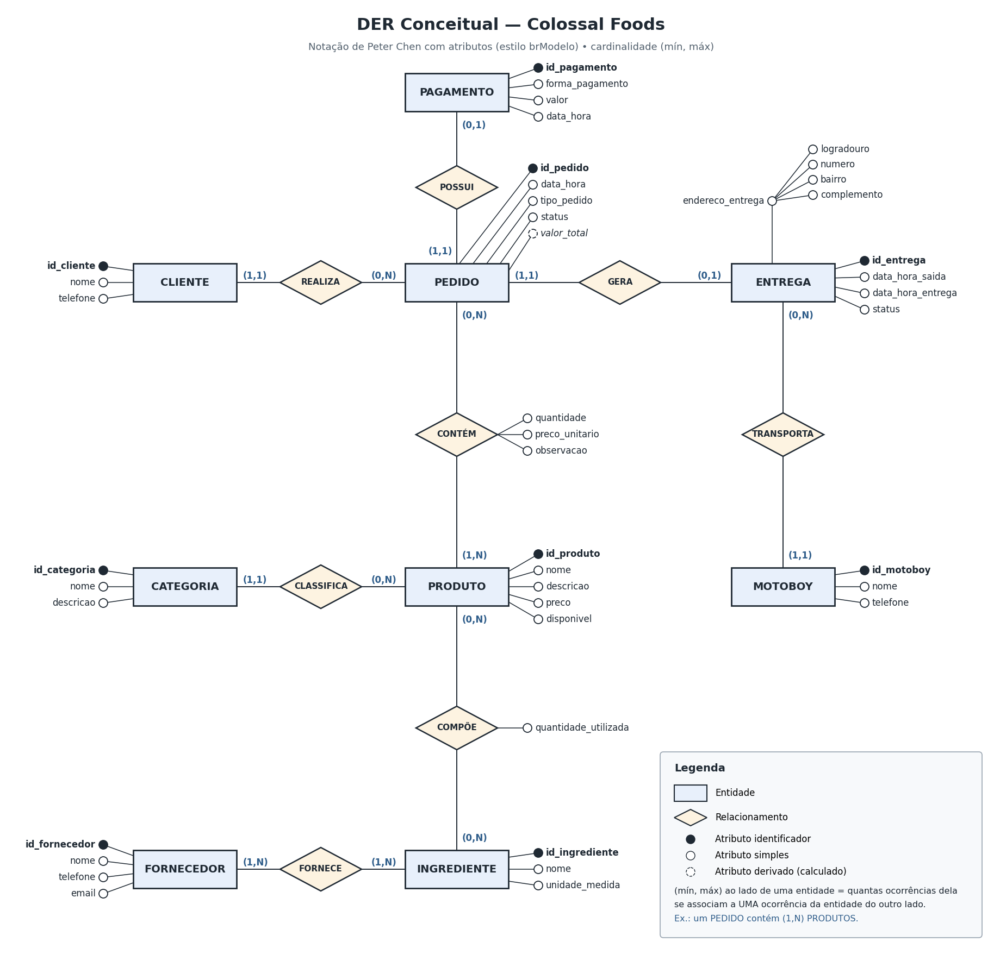
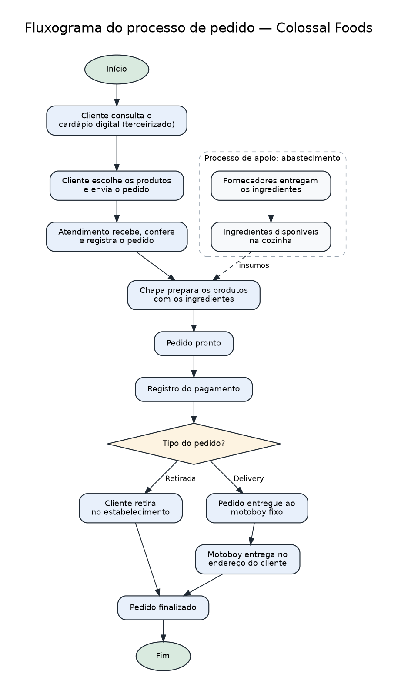

# Relatório Técnico Final — Colossal Foods
## Modelagem de dados, implementação SQL e apoio à gestão

**Curso:** Análise e Desenvolvimento de Sistemas — UNICID  
**Integrantes:** Murilo Silva Magalhães — RGM 47820471; Kauê de Lima Pereira — RGM 48477940  
**Banco de dados:** MySQL 8.0.16 ou superior  
**Repositório:** [mur1lxz/analise-dados-colossal-foods](https://github.com/mur1lxz/analise-dados-colossal-foods)

> **Sobre este relatório:** este README reúne as Entregas 1 e 2 no formato de relatório técnico solicitado. Os arquivos originais da Entrega 1 permanecem preservados em `entrega-1/`. Os artefatos técnicos da Entrega 2 permanecem em `entrega-2/`. Informações que ainda dependem de confirmação presencial estão identificadas como pendentes ou ilustrativas; não devem ser apresentadas como fatos confirmados.

---

# 1. Levantamento e modelagem conceitual — Entrega 1

## 1.1 Caracterização da organização

A **Colossal Foods** é uma empresa privada com fins lucrativos do segmento de alimentação, identificada no projeto como hamburgueria de pequeno/médio porte, localizada no Jardim Arantes, em São Paulo/SP.

No levantamento compartilhado pelo grupo, foram identificados quatro funcionários diretamente envolvidos na operação interna: duas pessoas na chapa/preparação e duas no atendimento, além de um motoboy fixo para delivery. O cardápio digital é fornecido por uma empresa terceirizada, contratada mediante pagamento mensal, e a equipe consulta as informações manualmente. O grupo não possui acesso ao banco de dados interno dessa plataforma.

O material do projeto registra uma estimativa de 30 a 50 pedidos por dia durante a semana e de 60 a 90 aos finais de semana. Esses números são estimativas de dimensionamento utilizadas no trabalho, não uma extração de dados do sistema da hamburgueria.

### Problemas e necessidades identificados

Os problemas foram organizados em identificadores para permitir rastreabilidade entre o levantamento, o banco de dados e as consultas gerenciais.

| Código | Problema/necessidade de informação | Objetivo do sistema |
|---|---|---|
| P1 | Acompanhamento do tempo de expedição do delivery | Registrar horários de recebimento, preparo, saída e conclusão para medir tempos e identificar atrasos. |
| P2 | Histórico de preços e custos | Preservar o preço praticado em cada venda e o custo de aquisição dos ingredientes ao longo do tempo. |
| P3 | Acompanhamento manual do estoque | Registrar entradas, saídas e ajustes, calcular saldos e sinalizar itens abaixo do mínimo cadastrado. |
| P4 | Acompanhamento de cancelamentos | Registrar mudanças de status, motivos, responsáveis e autorizações. |
| P5 | Conferência diária do caixa | Comparar pagamentos registrados por forma com os valores contados no fechamento. |
| P6 | Rastreabilidade de compras e fornecedores | Relacionar fornecedor, compra, nota fiscal, ingrediente, quantidades e custos. |
| P7 | Controle de áreas e taxas de delivery | Cadastrar áreas atendidas e preservar a taxa aplicada em cada entrega. |

P1 e P2 representam as necessidades centrais descritas na caracterização do projeto. P3 a P7 ampliam a cobertura informacional para os processos operacionais modelados após a revisão da primeira entrega. Devem ser entendidos como necessidades de informação propostas pelo grupo, e não como reclamações literais atribuídas ao responsável sem confirmação específica.

### Justificativa e escopo

A organização foi escolhida por ser uma empresa real acessível ao grupo para levantamento. O escopo considera os processos de atendimento, pedidos, preparação, pagamentos, retirada, delivery, abastecimento, recebimento de ingredientes, movimentação manual de estoque, fechamento de caixa e acompanhamento de preços e custos.

O projeto não pretende reproduzir o sistema terceirizado de cardápio nem afirmar integração automática com ele. O banco proposto organiza os registros necessários à operação interna e à análise gerencial.

### Levantamento, entrevista e evidências

O README da primeira entrega registra pesquisa de campo e conversa com a equipe. Também registra que não foram feitas fotografias durante a visita. O material disponível no repositório não documenta de forma completa a data e o local exatos da entrevista, o nome/função do entrevistado, os integrantes presentes, nem uma fotografia JPG/PNG da visita.

**Pendência documental:** completar esses dados somente com informações reais do grupo e anexar evidência autorizada, caso exista. Não foram inventados nome de entrevistado, data, participantes ou fotografia. O perfil público da organização pode ajudar a identificar a empresa, mas não substitui a evidência da entrevista exigida pelo roteiro do professor.

### Processos de negócio considerados

1. Consulta ao cardápio digital terceirizado.
2. Escolha e envio do pedido pelo cliente.
3. Recebimento, conferência e registro do pedido pelo atendimento.
4. Encaminhamento e preparação do pedido pela equipe da chapa.
5. Registro e associação do pagamento ao pedido.
6. Separação entre pedidos para retirada e pedidos para delivery.
7. Entrega ao cliente pelo motoboy fixo, quando aplicável.
8. Finalização ou cancelamento do pedido, conforme seu status.
9. Abastecimento de ingredientes por fornecedores.
10. Recebimento e conferência de insumos com nota fiscal.
11. Controle manual de entradas, saídas e ajustes de estoque.
12. Fechamento diário do caixa e conferência dos valores por forma de pagamento.
13. Registro de compras e acompanhamento dos custos dos ingredientes.

O controle de escala individual não foi incluído porque o levantamento disponível informa a composição geral da equipe, mas não confirma a escala de cada funcionário. A integração automática com o cardápio terceirizado também ficou fora do escopo por não haver acesso à plataforma.

### Requisitos funcionais

| Código | Requisito |
|---|---|
| RF01 | Registrar e consultar clientes. |
| RF02 | Cadastrar, consultar e marcar produtos como indisponíveis. |
| RF03 | Organizar produtos por categorias. |
| RF04 | Registrar pedidos. |
| RF05 | Incluir um ou mais produtos no pedido, com quantidade, preço praticado e observação. |
| RF06 | Calcular o total pela soma de quantidade × preço unitário dos itens e, para delivery, acrescentar a taxa registrada na entrega. |
| RF07 | Registrar o pagamento do pedido. |
| RF08 | Identificar se o pedido é para retirada ou delivery. |
| RF09 | Registrar a entrega e associar o motoboy responsável. |
| RF10 | Acompanhar o status do pedido e da entrega. |
| RF11 | Cadastrar ingredientes e sua composição nos produtos. |
| RF12 | Cadastrar fornecedores e relacioná-los aos ingredientes fornecidos. |
| RF13 | Manter o histórico de pedidos. |
| RF14 | Cadastrar funcionários e suas funções/situação, vinculando-os às operações quando identificados. |
| RF15 | Registrar compras por fornecedor, com data, status e itens comprados. |
| RF16 | Registrar recebimento de ingredientes, nota fiscal, data, conferente e quantidades recebidas. |
| RF17 | Registrar manualmente entradas, saídas e ajustes de estoque, com quantidade, data/hora, responsável e motivo. Não há baixa automática por venda nesta versão. |
| RF18 | Cadastrar áreas de entrega, taxa padrão e situação ativa/inativa, preservando a taxa aplicada em cada entrega. |
| RF19 | Registrar o fechamento de caixa e os valores contados por forma de pagamento. |
| RF20 | Registrar mudanças de status dos pedidos, com data/hora, funcionário responsável e justificativa/autorizador quando houver cancelamento. |

### Requisitos não funcionais

- **RNF01 — Usabilidade:** interface simples e adequada à rotina de uma operação de pequeno/médio porte.
- **RNF02 — Segurança:** acesso controlado aos dados de clientes, pedidos e pagamentos.
- **RNF03 — Disponibilidade:** disponibilidade durante o horário de funcionamento.
- **RNF04 — Desempenho:** registro e consulta de pedidos sem atrasos que prejudiquem o atendimento.
- **RNF05 — Integridade:** manutenção da consistência entre pedidos, produtos, ingredientes, pagamentos e entregas.
- **RNF06 — Privacidade:** uso dos dados pessoais somente para atendimento e entrega, respeitando a LGPD.

### Regras de negócio

- **RN01:** um cliente pode realizar vários pedidos; cada pedido pertence a um único cliente.
- **RN02:** todo pedido confirmado deve conter pelo menos um produto.
- **RN03:** um produto pode aparecer em vários pedidos.
- **RN04:** cada produto pertence a uma categoria.
- **RN05:** produto indisponível não pode ser incluído em novo pedido.
- **RN06:** a quantidade de cada item deve ser maior que zero.
- **RN07:** o preço do item deve preservar o valor praticado no momento da venda.
- **RN08:** cada pedido possui no máximo um pagamento; o pagamento corresponde ao total dos itens mais a taxa de delivery, quando houver.
- **RN09:** todo pedido deve ser classificado como retirada ou delivery.
- **RN10:** pedidos para retirada não possuem entrega.
- **RN11:** pedidos de delivery devem possuir uma entrega associada para serem concluídos.
- **RN12:** cada entrega possui um motoboy responsável; um motoboy pode realizar várias entregas.
- **RN13:** toda entrega possui endereço de destino.
- **RN14:** um pedido de delivery só pode ser finalizado depois que a entrega estiver concluída.
- **RN15:** produtos preparados podem ser compostos por ingredientes; produtos industrializados podem não possuir composição cadastrada.
- **RN16:** um ingrediente pode ser fornecido por mais de um fornecedor e um fornecedor pode fornecer vários ingredientes.
- **RN17:** cancelamentos após o início da preparação ou após o pedido ficar pronto exigem justificativa e autorização; o cancelamento no status inicial segue o fluxo registrado.
- **RN18:** as formas aceitas são PIX, dinheiro, cartão de débito e cartão de crédito; os valores devem ser conciliados no fechamento.
- **RN19:** delivery depende de área atendida e taxa cadastrada; a taxa efetivamente aplicada deve ser preservada no registro da entrega.
- **RN20:** recebimento de ingredientes exige conferência com nota fiscal e observância das normas sanitárias aplicáveis.
- **RN21:** uma compra só pode passar para RECEBIDA quando tiver nota fiscal, data de recebimento, conferente, resultado da conferência e ao menos um item com quantidade recebida maior que zero.
- **RN22:** o saldo do ingrediente é calculado por entradas e ajustes de entrada menos saídas e ajustes de saída; saldo negativo deve ser identificado.
- **RN23:** movimentação vinculada a item de compra deve ser do tipo ENTRADA, referir-se ao mesmo ingrediente e não superar a quantidade recebida.
- **RN24:** toda mudança de status gera histórico com data/hora e responsável; o status atual deve corresponder ao último evento registrado.

### DER conceitual revisado

O modelo conceitual preserva as entidades centrais **CLIENTE, PEDIDO, PRODUTO, CATEGORIA, INGREDIENTE, FORNECEDOR, PAGAMENTO, ENTREGA e MOTOBOY**. O relacionamento CONTÉM entre PEDIDO e PRODUTO mantém quantidade, preço praticado e observação como atributos do relacionamento; COMPÕE mantém quantidade utilizada; FORNECE representa o vínculo entre fornecedor e ingrediente.

O DER conceitual utiliza a notação de Peter Chen/brModelo: entidades em retângulos, relacionamentos em losangos, atributos em elipses, identificadores destacados, atributo composto de endereço e atributo derivado para o total do pedido. As cardinalidades mínimas e máximas são apresentadas no diagrama. Entidades associativas pertencem à conversão lógica, não ao DER conceitual desta versão.

**Fluxograma do processo de pedido:**

**Software e arquivos:** o material do DER inclui imagem PNG e arquivo-fonte Python em `entrega-1/diagramas/`. A imagem é o artefato visual preservado da Entrega 1. A validação formal de cada símbolo deve ser conferida no arquivo gráfico final.

### Revisões da Entrega 1 e justificativas

| Ponto revisto | Decisão adotada |
|---|---|
| Produto vendido e ingrediente consumido são conceitos diferentes | PRODUTO foi mantido e relacionado a INGREDIENTE por COMPÕE. |
| Fornecedor deve estar ligado aos ingredientes | FORNECE representa a relação N:N entre FORNECEDOR e INGREDIENTE. |
| Quantidade, preço e observação dependem da combinação pedido-produto | Permanecem como atributos de CONTÉM no conceitual e passam para ITEM_PEDIDO no lógico. |
| Preço precisa preservar o histórico da venda | O modelo lógico armazena `preco_unitario` em ITEM_PEDIDO. |
| Pagamento tem dados próprios e pode ocorrer após o registro do pedido | PAGAMENTO permanece separado e associado a PEDIDO. |
| Retirada não exige endereço nem motoboy | ENTREGA é opcional para PEDIDO no modelo físico; regras impedem entrega para retirada. |
| Operação de estoque e recebimento precisa de rastreabilidade | Foram acrescentadas estruturas de compra, item de compra e movimentação manual de estoque. |
| Caixa é conferido por forma de pagamento | Foram acrescentadas FECHAMENTO_CAIXA e CONFERENCIA_CAIXA. |
| Cancelamentos e mudanças de status precisam de histórico | Foi acrescentada HISTORICO_STATUS_PEDIDO. |
| Áreas de entrega e taxas precisam ser preservadas | Foi acrescentada AREA_ENTREGA e a taxa aplicada é copiada para ENTREGA. |

## 1.2 Conversão do modelo conceitual para o lógico

A conversão seguiu estas decisões:

1. Cada entidade conceitual tornou-se uma tabela relacional.
2. Atributos simples tornaram-se colunas; atributos compostos foram decompostos em colunas atômicas.
3. Relacionamentos 1:N foram implementados por chave estrangeira no lado N.
4. Relacionamentos N:N foram convertidos em tabelas associativas.
5. Relacionamentos 1:1 foram implementados por FK com restrição UNIQUE, quando necessário.
6. Atributos do relacionamento CONTÉM foram transferidos para ITEM_PEDIDO; o atributo quantidade_utilizada de COMPÕE foi transferido para PRODUTO_INGREDIENTE.
7. O total do pedido permanece derivado: soma dos itens mais taxa de entrega, quando existir. Não é armazenado como coluna redundante.

## 1.3 Modelo lógico relacional, chaves primárias e estrangeiras

O modelo implementado possui **20 tabelas**:

**Entidades principais:** CLIENTE, PEDIDO, PRODUTO, CATEGORIA, INGREDIENTE, FORNECEDOR, PAGAMENTO, ENTREGA e MOTOBOY.

**Tabelas associativas:** ITEM_PEDIDO, PRODUTO_INGREDIENTE e FORNECEDOR_INGREDIENTE.

**Estruturas complementares:** FUNCIONARIO, COMPRA, ITEM_COMPRA, MOVIMENTACAO_ESTOQUE, FECHAMENTO_CAIXA, CONFERENCIA_CAIXA, HISTORICO_STATUS_PEDIDO e AREA_ENTREGA.

### Chaves primárias

Todas as tabelas possuem PK. Nas tabelas com identificador simples, a PK é um campo `BIGINT UNSIGNED AUTO_INCREMENT`. As tabelas associativas PRODUTO_INGREDIENTE e FORNECEDOR_INGREDIENTE utilizam chaves primárias compostas:

- `PRODUTO_INGREDIENTE(id_produto, id_ingrediente)`
- `FORNECEDOR_INGREDIENTE(id_fornecedor, id_ingrediente)`

### Chaves estrangeiras

| Tabela | Chaves estrangeiras |
|---|---|
| PEDIDO | id_cliente → CLIENTE; id_funcionario_registro e id_funcionario_preparo → FUNCIONARIO |
| PRODUTO | id_categoria → CATEGORIA |
| PAGAMENTO | id_pedido → PEDIDO; id_fechamento → FECHAMENTO_CAIXA |
| ENTREGA | id_pedido → PEDIDO; id_motoboy → MOTOBOY; id_area_entrega → AREA_ENTREGA |
| ITEM_PEDIDO | id_pedido → PEDIDO; id_produto → PRODUTO |
| PRODUTO_INGREDIENTE | id_produto → PRODUTO; id_ingrediente → INGREDIENTE |
| FORNECEDOR_INGREDIENTE | id_fornecedor → FORNECEDOR; id_ingrediente → INGREDIENTE |
| COMPRA | id_fornecedor → FORNECEDOR; id_funcionario_conferente → FUNCIONARIO |
| ITEM_COMPRA | id_compra → COMPRA; id_ingrediente → INGREDIENTE |
| MOVIMENTACAO_ESTOQUE | id_ingrediente → INGREDIENTE; id_funcionario → FUNCIONARIO; id_item_compra → ITEM_COMPRA |
| FECHAMENTO_CAIXA | id_funcionario_responsavel → FUNCIONARIO |
| CONFERENCIA_CAIXA | id_fechamento → FECHAMENTO_CAIXA |
| HISTORICO_STATUS_PEDIDO | id_pedido → PEDIDO; id_funcionario_responsavel e id_funcionario_autorizador → FUNCIONARIO |

O modelo lógico completo contém as colunas, tipos, nulabilidade, PKs, FKs, restrições e cardinalidades: [abrir especificação do modelo lógico](entrega-2/modelo-logico-relacional.md). O diagrama lógico está em [SVG](entrega-2/diagramas/modelo-logico-colossal-foods.svg) e sua fonte em [Markdown/Mermaid](entrega-2/diagramas/modelo-logico-colossal-foods.md).

## 1.4 Normalização — 1FN, 2FN e 3FN

A estrutura foi organizada para reduzir repetição e anomalias de inserção, atualização e exclusão.

- **Primeira Forma Normal (1FN):** cada coluna representa um valor atômico. Endereço de entrega foi dividido em logradouro, número, complemento, CEP e área/bairro. Itens de pedido, itens de compra e formas de conferência são armazenados em registros separados, em vez de listas dentro de uma coluna.
- **Segunda Forma Normal (2FN):** nas tabelas com chave composta, os atributos não-chave dependem da chave completa. Em PRODUTO_INGREDIENTE, quantidade_utilizada depende do par produto–ingrediente; em FORNECEDOR_INGREDIENTE, o próprio par identifica a associação. Nas demais tabelas, as PKs são simples, evitando dependência parcial.
- **Terceira Forma Normal (3FN):** dados de entidades independentes foram separados. Nome de categoria fica em CATEGORIA, dados do fornecedor em FORNECEDOR, dados do motoboy em MOTOBOY, dados da área e taxa padrão em AREA_ENTREGA. As tabelas de pedido e compra guardam referências por FK em vez de repetir os dados descritivos dessas entidades. Preço praticado e custo unitário permanecem nos itens transacionais porque representam o valor histórico daquela venda/compra, não uma cópia do valor atual.

O valor_total do pedido e o saldo atual do ingrediente são calculados por consultas a partir dos itens, taxas e movimentações, evitando armazenar totais derivados que poderiam ficar inconsistentes.

## 1.5 Justificativas técnicas e integridade

- **Identificadores:** PKs numéricas BIGINT UNSIGNED com AUTO_INCREMENT facilitam a identificação dos registros.
- **Relacionamentos:** FKs garantem que os registros relacionados existam; a política de exclusão preserva o histórico operacional.
- **Valores monetários:** DECIMAL(10,2) evita imprecisão de ponto flutuante.
- **Quantidades de insumos:** DECIMAL(12,3) permite quantidades fracionadas.
- **Datas:** DATETIME registra data e hora local.
- **Domínios:** CHECKs limitam tipo/status do pedido, forma de pagamento, tipo de movimentação, status de compra e entrega.
- **Obrigatoriedade:** NOT NULL é usado nos dados essenciais; campos ainda desconhecidos no momento do cadastro podem aceitar NULL, como funcionário de preparo, data de recebimento e associação de pagamento ao fechamento.
- **Unicidade:** nomes de categoria e bairro/área são únicos; pagamento e entrega usam UNIQUE em id_pedido para limitar um registro de cada tipo por pedido; conferências são únicas por fechamento e forma.
- **Valores positivos:** CHECKs controlam quantidades, preços, custos e taxas não negativas/positivas conforme sua finalidade.
- **Preço histórico:** ITEM_PEDIDO.preco_unitario preserva o preço no momento da venda, mesmo que PRODUTO.preco seja alterado depois.
- **Estoque:** o saldo é calculado por movimentações manuais. Não há baixa automática por venda nesta versão.
- **Privacidade:** contatos de clientes e funcionários devem ter acesso restrito e ser usados somente para finalidades operacionais.

As regras que dependem de mais de uma tabela são complementadas por triggers e consultas de auditoria. O detalhamento de todas as colunas e restrições está no [dicionário lógico em HTML](entrega-2/dicionario-dados-logico.html).

## 1.6 BI, indicadores e apoio à decisão

O banco foi preparado para apoiar consultas gerenciais. Os indicadores abaixo são calculados a partir dos registros do sistema; metas e limites operacionais precisam ser definidos com a organização.

| Problema | Indicador / KPI | Fórmula ou critério | Consulta |
|---|---|---|---|
| P1 | Tempo médio de preparo | Média entre registro do pedido e início/fim do preparo conforme eventos disponíveis | G01 |
| P1 | Tempo médio de deslocamento | Média entre saída do motoboy e conclusão da entrega | G01 |
| P2 | Variação do preço de venda | Comparação entre preço atual do produto e preço histórico em ITEM_PEDIDO | G02 |
| P2/P6 | Variação do custo de aquisição | Comparação dos custos unitários registrados em ITEM_COMPRA ao longo do tempo | G03 |
| P3 | Ingredientes abaixo do mínimo | Saldo calculado menor que estoque_minimo cadastrado | G04 |
| P4 | Taxa de cancelamento | Pedidos cancelados ÷ total de pedidos no período × 100 | G05 |
| P5 | Diferença de caixa por forma | Valor contado menos total de pagamentos associados ao fechamento | G06 |
| P6 | Compras por fornecedor/ingrediente | Quantidade e custo das compras agrupados por fornecedor e ingrediente | G07 |
| P7 | Entregas e taxas por área | Quantidade de entregas e soma/média das taxas por área | G08 |

### Consultas gerenciais

- **G01:** tempos médios de preparo e deslocamento dos deliveries concluídos.
- **G02:** comparação entre preço atual e preço praticado historicamente.
- **G03:** análise de custos unitários de aquisição de ingredientes.
- **G04:** ingredientes abaixo do estoque mínimo cadastrado.
- **G05:** quantidade e percentual de pedidos cancelados.
- **G06:** conciliação de pagamentos por forma com valores contados.
- **G07:** compras por fornecedor e ingrediente.
- **G08:** entregas e taxas por área.

### Possibilidades futuras de BI/IA

Com maior histórico validado, os dados poderão apoiar previsões de demanda por dia/horário, identificação de ingredientes com maior risco de reposição e análise de variação de custos. Essas são possibilidades futuras, não funcionalidades de previsão já implementadas. Qualquer modelo preditivo exigiria dados históricos suficientes, validação de qualidade e acompanhamento humano.

---

# 2. Modelo lógico relacional

O modelo lógico possui 20 tabelas e 27 vínculos de chave estrangeira, conforme a especificação técnica e o diagrama. A notação do diagrama mostra tabelas, colunas, PKs, FKs e cardinalidades.

- [Modelo lógico relacional completo](entrega-2/modelo-logico-relacional.md)
- [Diagrama lógico em SVG](entrega-2/diagramas/modelo-logico-colossal-foods.svg)
- [Fonte Mermaid do diagrama](entrega-2/diagramas/modelo-logico-colossal-foods.md)
- [Dicionário de dados lógico em HTML](entrega-2/dicionario-dados-logico.html)

**Observação:** o Markdown/Mermaid documenta o modelo e facilita sua visualização. Caso o professor exija especificamente exportação do brModelo, a imagem final deve ser gerada/conferida no próprio brModelo e anexada ao repositório; não se deve declarar que um diagrama Mermaid foi produzido pelo brModelo.

---

# 3. Implementação SQL

O script principal está em [entrega-2/script.sql](entrega-2/script.sql). Ele utiliza MySQL e contém criação do banco, criação das tabelas, restrições, triggers, inserção de massa fictícia, consultas gerenciais e consultas de auditoria.

### Componentes implementados

- Banco de dados: `colossal_foods`.
- 20 tabelas relacionais.
- 27 vínculos de chave estrangeira documentados no modelo.
- 11 triggers para validações que envolvem mais de uma tabela.
- Consultas gerenciais G01–G08.
- Consultas de auditoria A01–A12.

As triggers complementam regras como indisponibilidade de produto, validação de pagamento, restrições de delivery, recebimento de compra, movimentação de estoque e autorização de cancelamentos. A descrição técnica está no modelo lógico e no próprio script SQL.

### Consultas de auditoria

| Código | Regra verificada |
|---|---|
| A01 | RN02 — pedido sem item de produto |
| A02 | RN08/RN19 — valor do pagamento em relação aos itens e à taxa de delivery |
| A03 | RN10/RN11 — coerência entre modalidade do pedido e existência de entrega |
| A04 | RN12 — entrega com motoboy responsável |
| A05 | RN22 — saldo de estoque não negativo |
| A06 | RN23 — movimentação de entrada coerente com item de compra |
| A07 | RN17 — cancelamento com justificativa e autorização quando exigida |
| A08 | RN18 — conciliação de pagamentos por forma |
| A09 | RN24 — status atual coerente com o último evento do histórico |
| A10 | RN20/RN21 — recebimento de compra documentado e conferido |
| A11 | RN18 — fechamento com registros de conferência |
| A12 | RN14 — delivery finalizado somente após entrega concluída |

### Execução no MySQL Workbench

1. Instalar/iniciar o MySQL Server 8.0.16 ou superior.
2. Abrir o MySQL Workbench e conectar ao servidor local.
3. Abrir o arquivo `entrega-2/script.sql`.
4. Executar o script completo, permitindo os comandos DELIMITER usados pelas triggers.
5. Atualizar a lista de schemas e confirmar a criação de `colossal_foods`.
6. Conferir as 20 tabelas e executar G01–G08 e A01–A12.

O passo a passo está no [guia de execução do MySQL](entrega-2/guia-execucao-mysql.md).

**Atenção:** o script contém comandos de criação do banco. Para recriar a demonstração do zero, o banco anterior deve ser removido conscientemente; isso apaga os dados existentes. Não executar DROP DATABASE em uma base com dados que devam ser preservados.

---

# 4. Massa de dados e validação

A massa de demonstração é inteiramente fictícia. O script contém:

| Registro | Quantidade |
|---|---:|
| Pedidos | 138 |
| Distribuição de pedidos | 34 em um dia útil, 39 em outro dia útil e 65 no sábado |
| Itens de pedido | 276 |
| Entregas | 44 |
| Pagamentos | 132 |
| Eventos de histórico de status | 484 |
| Compras | 5 |
| Itens de compra | 15 |
| Movimentações de estoque | 28 |
| Conferências de caixa | 12 |

Os nomes, telefones, e-mails, endereços, notas fiscais, preços, custos, taxas, quantidades e movimentações são ilustrativos. A distribuição foi escolhida para ser compatível com a estimativa de volume apresentada na caracterização, sem representar transações reais da empresa.

Jardim Arantes é a única área identificada no material do levantamento. Outros bairros, taxas e estoques mínimos usados na massa são exemplos demonstrativos e precisam de confirmação antes de serem descritos como parâmetros reais da hamburgueria.

### Resultado da execução registrado pelo grupo

O grupo executou o script no MySQL Workbench e as consultas gerenciais G01–G08. Após ajustar o valor contado no fechamento de caixa para R$ 453,00, as consultas de auditoria A01–A12 retornaram zero registros na massa de demonstração.

Esse resultado significa apenas que as verificações implementadas nessas consultas não encontraram as inconsistências que procuram nos dados atuais. Não comprova ausência de todo tipo de erro. A existência das 11 triggers foi conferida, mas não há afirmação de que cada trigger tenha passado por testes funcionais isolados em todos os cenários.

---

# 5. Organização do repositório e histórico

A estrutura atual preserva a documentação conceitual e mantém os artefatos da segunda entrega separados:

| Caminho | Conteúdo |
|---|---|
| `README.md` | Relatório técnico final integrado |
| `entrega-1/dicionario-dados.html` | Dicionário conceitual da primeira entrega |
| `entrega-1/diagramas/DER-Colossal-Foods.png` | DER conceitual |
| `entrega-1/diagramas/fluxograma-Colossal-Foods.png` | Fluxograma do processo de pedido |
| `entrega-1/diagramas/gerar_der.py` | Arquivo-fonte de geração do DER |
| `entrega-1/diagramas/fluxograma.dot` | Fonte do fluxograma |
| `entrega-2/modelo-logico-relacional.md` | Especificação lógica, colunas, tipos, PK, FK e cardinalidades |
| `entrega-2/diagramas/modelo-logico-colossal-foods.svg` | Diagrama lógico |
| `entrega-2/diagramas/modelo-logico-colossal-foods.md` | Fonte Mermaid do diagrama |
| `entrega-2/dicionario-dados-logico.html` | Dicionário físico/lógico MySQL |
| `entrega-2/script.sql` | Script SQL completo |
| `entrega-2/adendo-rastreabilidade.md` | Detalhamento de problemas, requisitos, regras e rastreabilidade |
| `entrega-2/guia-execucao-mysql.md` | Guia para executar e validar o banco |
| `entrega-2/apresentacao-final.md` | Roteiro da apresentação final |

O histórico de commits do GitHub deve demonstrar a evolução real do trabalho e as contribuições dos integrantes. Cada participante deve realizar seus próprios commits com sua conta. Não se deve atribuir contribuições que não foram feitas por aquela pessoa. A distribuição de commits e a identificação dos autores devem ser conferidas diretamente na aba de histórico do repositório.

---

# 6. Uso de inteligência artificial

A IA foi utilizada como apoio à organização, revisão e implementação. As sugestões foram tratadas como hipóteses e comparadas com o levantamento, os arquivos do repositório, a correção da atividade e os testes no MySQL.

| Etapa | Ferramenta | Motivação e prompts registrados | Resultado aproveitado e revisão |
|---|---|---|---|
| Preparação do levantamento | ChatGPT | “Chat, preciso fazer uma entrevista com uma empresa e entender como funciona o sistema deles de dados e montar um fluxo e fazer um MER e DER.” | Sugestões de perguntas sobre pedidos, clientes, pagamentos, estoque e delivery; hipóteses não confirmadas, como estoque automático, foram retiradas. |
| Estruturação conceitual | ChatGPT | “A empresa que vou é uma hamburgueria de baixo/médio porte, é possível adiantar algo?” | Sugestão inicial de entidades e processos; o grupo manteve apenas o que era coerente com o levantamento e revisou o modelo. |
| Organização do README | ChatGPT | “Mude o arquivo para esse formato: Entrega 1 — Modelo Conceitual (DER).” | Organização do relatório conforme a estrutura acadêmica, com revisão humana das afirmações. |
| Revisão do repositório | Claude (Anthropic) | “Analise esse projeto e verifique se está correto.”; “Monte o projeto inteiro de forma atualizada e correta com dicionário em HTML, o DER e o fluxograma.” | A revisão apontou divergências entre README, DER e dicionário. PRODUTO foi mantido e ligado a INGREDIENTE; relacionamentos N:N e cardinalidades foram revistos. O grupo deve completar no registro de trabalho quais sugestões específicas rejeitou ou corrigiu, se necessário. |
| Modelo lógico e SQL | ChatGPT | “Revise o modelo lógico para ver se está tudo certo e faça a próxima etapa.” | Apoio à conversão em tabelas, definição de chaves, restrições, massa fictícia e consultas. Foram revistas hipóteses não confirmadas, cálculo do delivery, recebimento de compras e conciliação do caixa. |

**Fontes de validação:** roteiro da atividade e correção da Entrega 1, arquivos do próprio repositório, informações operacionais compartilhadas pelo grupo e execução do script no MySQL Workbench. A IA não foi tratada como fonte de evidência sobre a empresa.

**Limitações e reflexão crítica:** respostas geradas podem sugerir processos comuns do setor que não existem na organização analisada. Por isso, integração automática, parâmetros de estoque, bairros, taxas e escala individual não foram declarados como fatos sem confirmação. O modelo e os dados fictícios precisam continuar sendo revisados pelo grupo e pela organização.

---

# 7. Apresentação final — pitch de 8 minutos

A apresentação deve ser visual, objetiva e conter pouco texto por slide. A sequência recomendada é:

1. **Capa:** Colossal Foods — Sistema de Gestão de Informações.
2. **Organização e contexto:** operação, equipe, cardápio terceirizado e processos.
3. **Problema e objetivo:** expedição, histórico de preços/custos, estoque, caixa e compras.
4. **Modelo conceitual:** entidades e relacionamentos principais da Entrega 1.
5. **Modelo lógico:** 20 tabelas, PKs, FKs e tabelas associativas.
6. **Implementação SQL:** banco, tabelas, triggers e demonstração de execução.
7. **Consultas gerenciais:** G01–G08 e indicadores.
8. **Auditoria e validação:** A01–A12 e resultado da massa fictícia.
9. **Limitações e próximos passos:** pontos que dependem de confirmação e testes funcionais adicionais.
10. **Conclusão:** benefícios esperados e possibilidade de evolução.

### Divisão sugerida para oito integrantes

1. Integrante 1: slides 1–2 — apresentação e contexto da organização.
2. Integrante 2: slide 3 — problemas e objetivos.
3. Integrante 3: slide 4 — modelo conceitual.
4. Integrante 4: slide 5 — modelo lógico.
5. Integrante 5: slide 6 — implementação SQL.
6. Integrante 6: slide 7 — consultas gerenciais.
7. Integrante 7: slide 8 — auditoria e validação.
8. Integrante 8: slides 9–10 — limitações e conclusão.

A divisão é uma sugestão e deve ser ajustada aos integrantes reais e ao tempo disponível. Todos devem conhecer o funcionamento geral do projeto para responder às perguntas da banca.

O roteiro de fala e os tópicos dos slides estão em [apresentacao-final.md](entrega-2/apresentacao-final.md).

---

## Pendências que precisam de validação antes da entrega definitiva

- Completar os dados factuais da entrevista (data, local, função do entrevistado e integrantes presentes), se o grupo tiver esses registros.
- Anexar fotografia/evidência autorizada da visita, caso exista; o material anterior informa que não houve registro fotográfico.
- Confirmar bairros atendidos, taxas, estoques mínimos e processo formal de compras com a organização.
- Conferir se o diagrama lógico atende à exigência de notação e exportação do brModelo, caso o professor exija especificamente essa ferramenta.
- Executar cenários de teste funcionais para cada trigger, além de conferir sua existência.
- Conferir o histórico de commits e a participação real dos integrantes.

**Entrega:** este README é o relatório integrado; os diagramas, dicionários, script SQL, guia de execução e apresentação permanecem como arquivos separados e vinculados acima.
