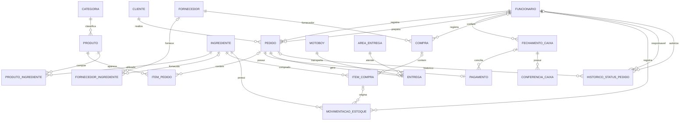

# Diagrama lógico relacional — Colossal Foods

> Prévia Mermaid dos relacionamentos entre as 20 tabelas da implementação MySQL. A lista completa de colunas, tipos, PKs, FKs e restrições está em [modelo-logico-colossal-foods-revisado.md](../modelo-logico-colossal-foods-revisado.md).

## Leitura do diagrama

- `||`: exatamente um registro relacionado.
- `o|`: zero ou um registro relacionado.
- `o{`: zero ou muitos registros relacionados.
- `ITEM_PEDIDO`, `PRODUTO_INGREDIENTE` e `FORNECEDOR_INGREDIENTE` implementam relacionamentos N:N.
- `PRODUTO_INGREDIENTE` possui PK composta (`id_produto`, `id_ingrediente`).
- `FORNECEDOR_INGREDIENTE` possui PK composta (`id_fornecedor`, `id_ingrediente`).
- `PAGAMENTO.id_pedido` e `ENTREGA.id_pedido` são únicos, limitando cada pedido a no máximo um pagamento e uma entrega.

**Importante:** esta prévia Mermaid ajuda a visualizar os relacionamentos no GitHub, mas não substitui o diagrama lógico exportado do brModelo caso a atividade exija essa ferramenta.
